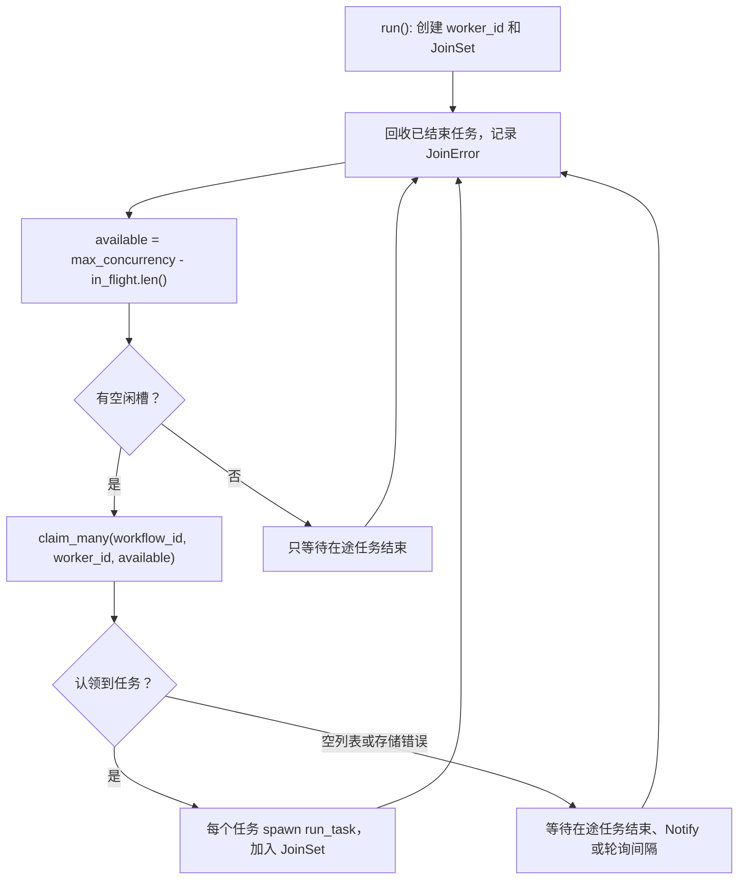
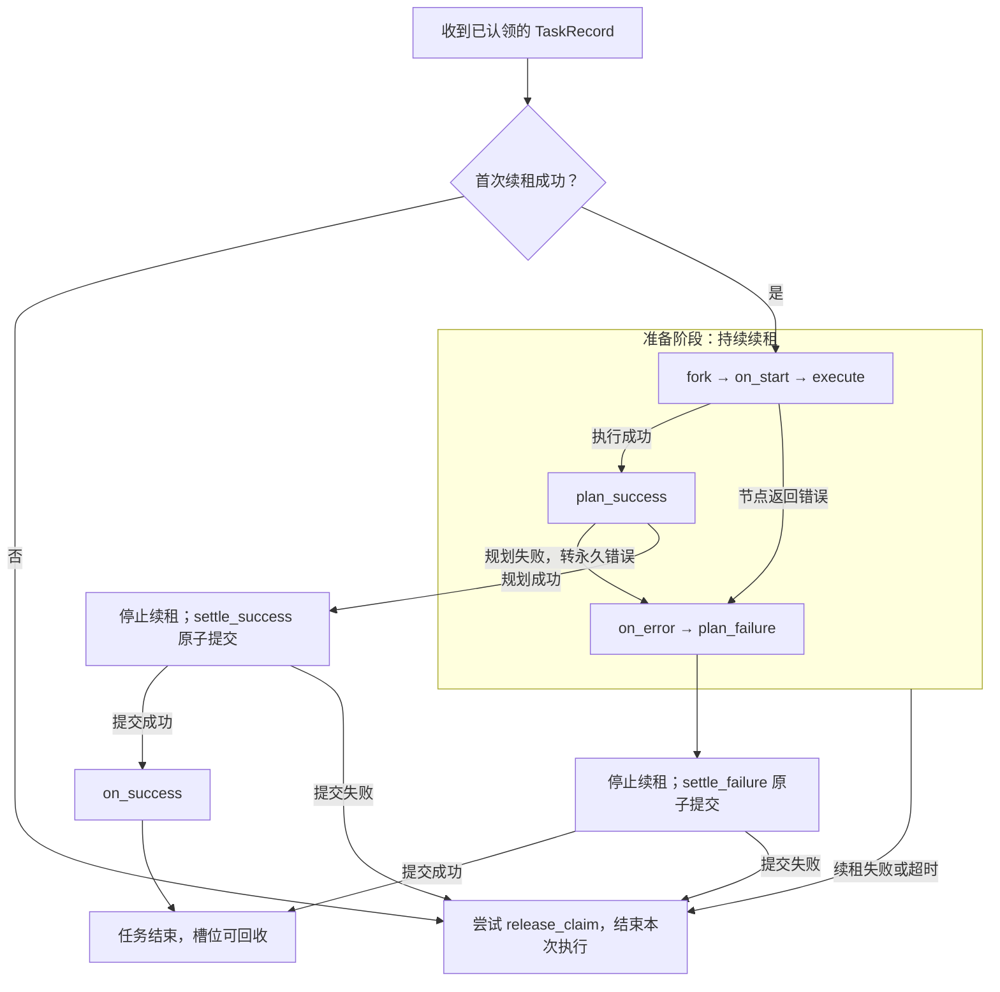

# Scheduler 设计与调度流程

本文描述当前实现：`Workflow::submit` 创建独立运行并自动驱动调度器，
`Scheduler::run()` 持续执行，生命周期由所属实例管理。

核心代码：[Scheduler](../src/scheduler.rs)、[Workflow](../src/workflow.rs)、
[TaskStore](../src/task/store.rs)、[Graph](../src/graph/mod.rs)。

## 职责与运行范围

一个 Scheduler 绑定一张固定的 Graph，按 `workflow_id` 认领该图所有运行的任务。
数据库保存待执行任务和依赖关系；调度器只在有空槽时认领，不在内存中维护另一份待执行队列。

| 组件 | 职责 |
| --- | --- |
| `Workflow` | 提交入口任务、首次提交时启动后台调度器、唤醒认领、随实例释放取消后台任务 |
| `Scheduler` | 计算空闲槽、批量认领、并发执行、准备阶段续租、调用存储结算及异常释放 |
| `Graph` | 提供节点与上下文，执行节点钩子和业务逻辑，规划成功或失败后继 |
| `TaskStore` | 原子创建运行，筛选可认领任务，校验认领归属，原子提交状态与后继 |
| 数据库后端 | 实现依赖与 JOIN 闸门、租约、尝试预算和并发事务控制 |

`run_id` 标识一次提交产生的运行，`worker_id` 标识一次调度循环。一次调度循环生成一个
UUID 作为 `worker_id`，可以处理同一 `workflow_id` 下多个不同 `run_id` 的任务。
不同运行的扇入与 JOIN 判定由存储隔离。

并发上限属于 Scheduler 实例。一个 Workflow 的所有运行共享默认 8 个槽；若为同一个
`workflow_id` 创建多个实例，每个实例都有自己的额度，8 不是跨实例或跨进程的全局上限。
存储通过认领凭据防止旧执行者覆盖新认领的结果。

## 从提交到启动

`Engine::make(graph)` 构造 Workflow 和 Scheduler，此时不启动调度。
每次 `Workflow::submit(entry, input)` 按以下顺序执行：

1. 检查入口节点存在，将输入序列化为 JSON。节点 `In` 类型的反序列化检查留到实际执行阶段。
2. 调用 `TaskStore::create_run`，在同一事务内分配 `run_id` 并保存入口任务。
3. 通过 `OnceLock` 确保本实例只启动一次后台 `scheduler.run()`；并发提交不会重复启动。
4. 调用共享 `Notify::notify_one()` 唤醒认领，返回包含 `workflow_id`、`run_id` 和入口 `task_id` 的 `RunHandle`。

成功返回表示入口任务已持久化并安排执行，不等待节点完成。首次提交失败不会启动调度器。
启动后的调度器会认领当前图已有的可执行任务，而非仅执行触发启动的那次提交。

Workflow 持有图与存储的共享句柄，Engine 释放不影响它。执行期间需要保留 Workflow；
实例释放会通过 `Worker::drop` 中止后台任务，继而取消调度器的在途任务。
`RunHandle` 只保存运行身份，持有它不会延长 Workflow 的生命周期。

## 主调度循环：按空槽补充任务

`run()` 创建 `worker_id` 和 `JoinSet<()>`，然后进入 `run_loop`。
`JoinSet` 跟踪本实例已认领且尚未回收的 task future，其长度用于计算并发额度。

每轮先用 `try_join_next` 回收全部已结束任务，再计算空槽。认领数量最多为 `available`，
返回任务后逐个 spawn，随后立即进入下一轮补槽；不会等待整批任务都执行完。
`claim_many` 返回空列表或报错时进入等待，存储错误会记录日志，不退出调度循环。

等待阶段由 `tokio::select!` 驱动：

| 等待事件 | 启用条件 | 作用 |
| --- | --- | --- |
| `in_flight.join_next()` | 至少有一个在途任务 | 回收任务并释放执行槽，继续认领 |
| `wake.notified()` | 有空槽 | 本进程新提交后立即尝试认领 |
| `sleep(poll)` | 有空槽 | 再次查询数据库，发现其他来源入队或租约过期后可认领的任务 |

同时就绪时，选择顺序是任务完成、通知、轮询。满槽时不轮询，也不消耗就绪通知；
有槽时，即使其他节点很慢，通知仍可唤醒认领。Notify 只是唤醒信号，可以合并多次通知，
任务是否存在和可执行始终以数据库为准。
Scheduler 本身不建立 PostgreSQL LISTEN；外部入队由轮询或宿主接入的唤醒源发现。

Workflow 使用 1 秒轮询间隔；直接构造 Scheduler 时由调用方传入 `poll`，并可用
`with_max_concurrency` 设置并发上限，最小值为 1。轮询间隔是进入等待后的休眠时长，
不是每秒固定扫描一次，也不是每个任务启动前都要等待的延迟。

一个槽覆盖整个 `run_task`：上下文准备、业务执行、图规划、数据库结算、成功回调，
以及异常时的认领释放。槽位计数不等同于数据库中 `running` 状态的行数。

## 认领与依赖就绪

调度器把 `workflow_id`、`worker_id` 和数量上限交给 `TaskStore::claim_many`。
当前 PostgreSQL / SQLite 后端负责筛选待执行或租约已过期的任务、检查依赖和 JOIN
是否就绪、限制尝试预算，再原子写入 `running`、持有人、租约及递增后的 `attempt`。
认领事务还会将当前图中满足执行闸门、但预算已耗尽的任务封存为 `failed`。

任务按存储的认领顺序进入执行槽，完成顺序取决于各节点耗时；调度器不提供按 run
轮转的公平队列。后继通过结算事务入库，满足依赖后由下一次认领取得，不在当前任务里
递归执行。其他槽可以继续推进快分支，慢分支保持在途。

## 单个任务：准备、结算与回调

每个 `run_task` 分为 `prepare_with_lease` 和 `settle` 两阶段。

### 准备阶段

首次续租成功后，按顺序执行 `NodeContext::fork(task)`、`on_start` 和节点 `execute`。
每个任务获得独立上下文，图和节点实例仍通过共享句柄复用。

执行成功后，`Graph::plan_success` 生成后继，并转换为存储使用的 `FanoutPlan`。
若成功后继规划出错，则转为永久业务错误，进入同一失败路径。

执行或成功后继规划失败时，先调用 `on_error`，再用原始输入和错误调用
`Graph::plan_failure`。失败后继规划本身出错时记录日志，使用空后继列表结算失败。
准备阶段生成结果与入队计划，不提交任务状态。

续租规则如下：

- 租约时长 `LEASE_DURATION` 为 300 秒，执行任何业务钩子前先续租一次。
- 准备期间每等待 `LEASE_DURATION / 3`（100 秒）后续租，单次续租也以 100 秒为超时上限。
- 续租覆盖 `fork`、`on_start`、`execute`、后继规划和 `on_error`。
- 续租失败或超时后丢弃准备 future；同时就绪时优先处理续租失败。
  此时不生成业务失败后继，而是进入认领释放路径。

### 结算阶段

准备完成后续租停止。存储必须在结算事务中再次验证任务状态、`claimed_by`、`attempt`
以及数据库时间下的租约有效性；旧认领不能提交结果或创建后继。

| 准备结果 | 原子存储操作 | 提交后的动作 |
| --- | --- | --- |
| 成功 | `settle_success` 写入输出、标记 `succeeded`、入队全部成功后继 | 调用 `on_success`，然后结束任务 |
| 失败且后继计划非空 | `settle_failure` 标记 `superseded`，入队失败后继 | 结束任务 |
| 失败且后继计划为空 | `settle_failure` 标记 `failed`，级联同一运行中已有的直接依赖 pending 任务 | 结束任务 |

状态变更和后继入队在同一事务内提交，任一步失败整体回滚。
`on_error` 发生在失败结算之前，`on_success` 仅在成功结算之后调用。
成功回调期间不续租，但仍占执行槽；后继已经入库，可能由其他空槽或其他 worker
在该回调结束前执行。因此 `on_success` 不构成后继任务的依赖屏障。

## 异常、取消与恢复

| 情况 | 当前处理 |
| --- | --- |
| 认领报错 | 记录错误，按主循环的事件或轮询机制再次尝试 |
| 准备阶段失去租约 | 取消准备，尝试释放旧认领，不结算为业务失败 |
| 结算报错 | 记录错误，尝试释放认领，预算允许时可再次认领执行 |
| 单任务准备、结算或成功回调 panic | `run_task` 捕获 panic，记录错误并尝试释放认领 |
| 认领释放失败 | 记录警告；后续由存储的租约与恢复机制处理 |
| 调度主循环 panic | 取消并等待 JoinSet 中的任务退出，再传播 panic |
| Workflow 释放或 run future 被取消 | 取消在途任务，不等待结算，也不会自动执行异步认领释放 |

释放认领同样校验当前有效持有人和 `attempt`。已经过期、被接管或结算到终态的任务，
不会被旧执行者的清理操作改回待执行。成功回调 panic 时，已提交的成功状态和后继不会回滚。
成功结算与回调之间仍可能发生进程退出，因此 `on_success` 不保证必达，也没有独立的补发机制。

`NodeError::Retryable` 不会在当前调度器里自动触发退避或重新执行同一任务；业务错误会
经过失败边规划与失败结算。因结算异常、任务 panic 或租约过期而重新认领时会消耗新的
`attempt`，是否仍可执行由存储的 `max_attempts` 决定。

实例取消时已经发生的外部副作用不会撤回，未结算任务的认领可能保留到租约过期。
重新认领可能重复执行业务逻辑，外部写入应按任务身份设计幂等；数据库原子结算不提供
外部副作用的 exactly-once 保证。Tokio 的取消在异步任务让出执行权时生效。

已经启动的 Scheduler 只轮询自己绑定的图。进程重启后，仅 `Engine::make` 不会执行
存量任务；首次新提交会启动该图调度，宿主也可直接驱动底层 Scheduler 恢复存量任务。
跨工作流恢复由宿主先调用 `seal_budget_exhausted` 封存符合执行闸门的耗尽任务，再通过
`executable_workflow_ids` 找出可调度的图；封存不执行失败边，也不递归传播失败。
详见 [README 的数据库说明](../README.md)。当前 Workflow 不自动重启发生 panic 的调度器。

## 代码导航

| 实现位置 | 阅读重点 |
| --- | --- |
| [src/workflow.rs](../src/workflow.rs) | `submit`、首次启动、就绪通知、`Worker::drop` |
| [src/scheduler.rs](../src/scheduler.rs) | `run_loop` → `claim_and_spawn` → `run_task` → `prepare_with_lease` → `prepare` → `settle` |
| [src/task/store.rs](../src/task/store.rs) | 存储契约、`FanoutPlan`、租约时长 |
| [src/graph/mod.rs](../src/graph/mod.rs) | 节点执行、成功与失败后继规划 |
| [src/backend/pgsql/repo.rs](../src/backend/pgsql/repo.rs) | PostgreSQL 认领、结算、续租和恢复查询 |
| [src/backend/sqlite/repo.rs](../src/backend/sqlite/repo.rs) | SQLite 认领、结算、续租和恢复查询 |
| [tests/sqlite_backend.rs](../tests/sqlite_backend.rs) | 提交自动执行、共享槽、通知唤醒、扇出与 JOIN 的现有验证 |
