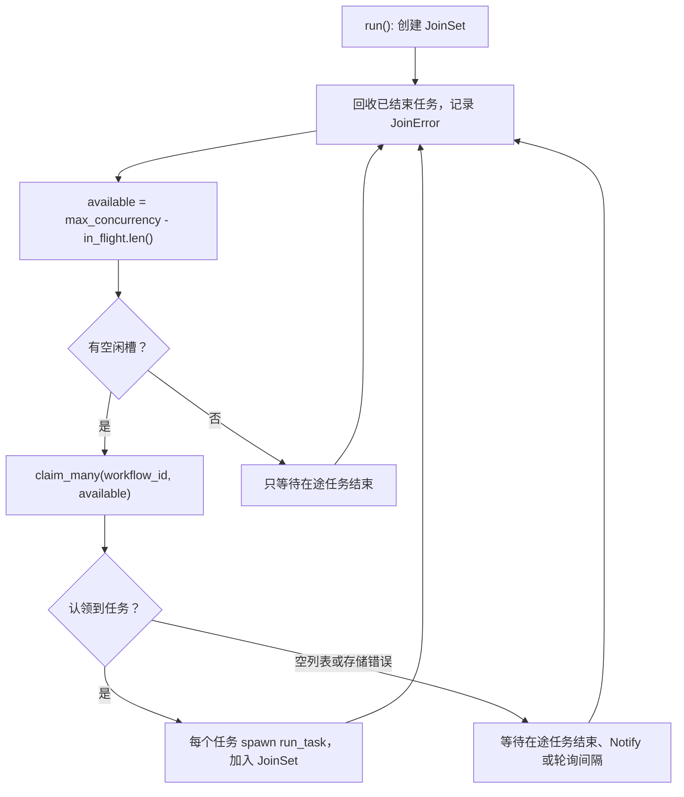
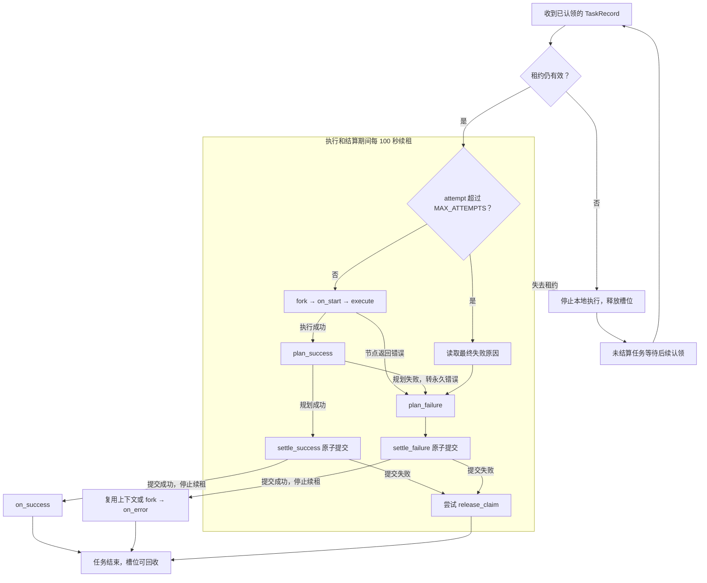

# Scheduler 设计与调度流程

本文描述当前实现：`Engine::make(graph)` 创建工作流实例并立即启动调度器，
`Workflow::submit` 创建独立运行并唤醒认领。`Scheduler::run()` 持续执行，生命周期由所属实例管理。

核心代码：[Scheduler](../src/scheduler.rs)、[Workflow](../src/workflow.rs)、
[任务存储](../src/task/store.rs)、[Graph](../src/graph/mod.rs)。

## 职责与运行范围

一个 Scheduler 绑定一张固定的 Graph，按 `workflow_id` 认领任务。
数据库保存任务和实际来源；调度器只在有空槽时认领，不在内存中维护另一份待执行队列。

| 组件 | 职责 |
| --- | --- |
| `Workflow` | 构造时启动后台调度器、提交入口任务、唤醒认领、随实例释放取消后台任务 |
| `Scheduler` | 计算空闲槽、批量认领、执行期间续租、调用存储结算及异常释放 |
| `Graph` | 提供节点与上下文，执行节点钩子和业务逻辑，规划成功或失败后继 |
| `TaskStore` | 在事务内创建运行及入口任务 |
| `ExecutionStore` | 筛选可认领任务，续租并校验认领归属，原子提交状态与后继 |
| 数据库后端 | 实现依赖与 JOIN 闸门、租约、尝试预算和并发事务控制 |

`run_id` 标识一次提交产生的运行。一次调度循环可以处理同一工作流的多个运行。
不同运行的 JOIN 汇合与前驱判定由存储隔离。同一运行内，每次子图调用拥有独立的 `scope_id`。
同次结算的普通跨入边共享子图实例，foreach 按元素创建实例。退出子图时沿持久化的父子关系恢复祖先。
成功边的对象贡献合入同一运行、作用域和节点下状态为 `collecting` 的任务。前驱就绪后，首次认领直接转为 `running`，输入随即固定。
失败边和独立运行入口各自创建 `pending` 任务，等待直接认领。

并发上限属于 Scheduler 实例。一个 Workflow 的所有运行共享默认 8 个槽；若为同一个
`workflow_id` 创建多个实例，每个实例都有自己的额度，8 不是跨实例或跨进程的全局上限。
存储通过认领凭据防止旧执行者覆盖新认领的结果。

## 实例启动与提交

`Engine::make(graph)` 构造 Workflow 和 Scheduler，并启动一次后台 `scheduler.run()`。
因此 `make` 必须在 Tokio runtime 内调用。调度器开始认领该图已有的可执行任务，无需先提交新运行。
每次 `Workflow::submit(entry, input)` 按以下顺序执行：

1. 将输入序列化为 JSON，根据图描述校验入口并构造带子图路径的 `Task`。节点 `In` 类型的反序列化检查留到实际执行阶段。
2. 调用 `Database::submit(task)`。存储层在同一事务内分配 run ID、创建子图实例并保存入口任务。
3. 调用共享 `Notify::notify_one()` 唤醒认领，返回包含 `workflow_id` 和 `run_id` 的 `RunHandle`。

成功返回表示入口任务已持久化并安排执行，不等待节点完成。提交不会创建调度器，
提交失败也不影响已经启动的调度器。所有运行共享构造时启动的同一个后台任务。

外部事件入口声明 `TaskType::Event`，通过 `Node::trigger()` 提供注册配置。
宿主从 `Workflow::triggers()` 获取节点名及声明，自行注册触发器并在事件到达时调用 `submit`。
Scheduler 不注册或监听触发源；已入队的 Event 任务按普通任务认领、执行与结算。

控制面可以通过 `SubmitTask` 在已有的 SQLx 事务中调用 `tx.submit(task)`，让 cron 入队与触发游标共同提交。入口任务的 `task_id` 同时标识新 run。后继在执行端结算时继承同一个 `workflow_id` 和 `run_id`。

Workflow 持有图与存储的共享句柄，Engine 释放不影响它。执行期间需要保留 Workflow；
实例释放会通过 `Workflow::drop` 中止后台任务，继而取消调度器的在途任务。
`RunHandle` 只保存运行身份，持有它不会延长 Workflow 的生命周期。

## 主调度循环：按空槽补充任务

`run()` 创建 `JoinSet<()>`，然后进入 `run_loop`。
`JoinSet` 跟踪本实例已认领且尚未回收的 task future，其长度用于计算并发额度。

每轮先用 `try_join_next` 回收全部已结束任务，再计算空槽。认领数量最多为 `available`，
返回任务后逐个 spawn，随后立即进入下一轮补槽；不会等待整批任务都执行完。
`claim_many` 返回空列表或报错时进入等待，存储错误会记录日志，不退出调度循环。

等待阶段由 `tokio::select!` 驱动：

| 等待事件 | 启用条件 | 作用 |
| --- | --- | --- |
| `in_flight.join_next()` | 至少有一个在途任务 | 回收任务并释放执行槽，继续认领 |
| `wake.notified()` | 有空槽 | 本进程新提交后立即尝试认领 |
| `sleep(poll)` | 有空槽 | 再次查询数据库，发现其他来源入队或租约过期后可认领的任务 |

同时就绪时，选择顺序是任务完成、通知、轮询。满槽时不轮询，也不消耗就绪通知；
有槽时，即使其他节点很慢，通知仍可唤醒认领。Notify 只是唤醒信号，可以合并多次通知，
任务是否存在和可执行始终以数据库为准。
Scheduler 本身不建立 PostgreSQL LISTEN；其他进程提交的任务由轮询发现。

Workflow 使用 1 秒轮询间隔和 8 个执行槽，Scheduler 的构造与配置由库内部管理。
轮询间隔是进入等待后的休眠时长，
不是每秒固定扫描一次，也不是每个任务启动前都要等待的延迟。

一个槽覆盖整个 `run_task`：上下文准备、业务执行、图规划、数据库结算、成功或错误回调，
以及异常时的认领释放。槽位计数不等同于数据库中 `running` 状态的行数。

## 认领与依赖就绪

调度器把 `workflow_id` 和数量上限交给 `ExecutionStore::claim_many`。
当前 PostgreSQL / SQLite 后端负责筛选待执行或租约已过期的任务、检查依赖和 JOIN
是否就绪，再原子写入 `running`、初始 300 秒租约及递增后的 `attempt`。

`attempt` 是参与写入校验的认领代次，每次认领都递增。引擎常量 `MAX_ATTEMPTS` 将每条任务的业务执行次数限制为 3 次：

- 认领返回的 `attempt <= MAX_ATTEMPTS`：执行节点及其生命周期钩子。
- 认领返回的 `attempt > MAX_ATTEMPTS`：只处理最终失败，跳过 `on_start` 和节点 `execute`。
  这类认领同样持有可续期的租约，以便安全规划、提交失败后继。

认领事务首次发现预算耗尽时记录最终失败原因：旧租约已到期则记录租约失效；
提前释放的认领记录预算耗尽。后续恢复认领保留该原因。
预算耗尽的行继续参与认领和恢复查询，由统一失败结算处理，不直接封存为 `failed`。

任务按存储的认领顺序进入执行槽，完成顺序取决于各节点耗时；调度器不提供按 run
轮转的公平队列。后继通过结算事务入库，满足依赖后由下一次认领取得，不在当前任务里
递归执行。其他槽可以继续推进快分支，慢分支保持在途。

## 单个任务：执行、结算与回调

每个 `run_task` 在执行、后继规划和结算期间维护租约；终态提交后停止续租，再执行回调。
引擎不限制业务执行或回调时长。
正常执行通过 `execute_and_plan` 返回包含执行结果与后继计划的 `ExecutionOutcome`；
预算耗尽的认领直接进入同一 `plan_failure` 辅助函数，复用同步失败边规划。
失败结果保留 `NodeError` 和可选上下文：正常业务失败沿用执行上下文，恢复处理在失败提交后才创建回调上下文。

### 执行阶段

租约有效且仍有执行次数时，按顺序执行 `NodeContext::fork(task)`、`on_start` 和节点 `execute`。
每个任务获得独立上下文，图和节点实例仍通过共享句柄复用。

执行成功后，`Graph::plan_success` 生成后继，并转换为存储使用的 `FanoutPlan`。
若成功后继规划出错，则转为永久业务错误，进入同一失败路径。

执行或成功后继规划失败时，用原始输入和错误调用 `Graph::plan_failure`，
保留执行上下文供失败提交后的 `on_error` 使用。失败后继规划本身出错时记录日志，使用空后继列表结算失败。
执行阶段生成结果与入队计划，不提交任务状态。

### 租约与运行时长

- 认领时按数据库时间设置 `lease_until = 当前时间 + LEASE_DURATION`，租约时长为 300 秒。
- `fork`、`on_start`、`execute`、后继规划和结算期间，调度器每 100 秒调用一次 `renew_claim`。
  续租成功后，租约截止时间延长到数据库当前时间后的 300 秒，不增加 `attempt`。
- 续租必须匹配 `workflow_id`、`task_id`、`attempt`、`running` 状态及仍有效的租约。
  过期租约不能被旧执行者续期；重新认领会分配新的执行代次。
- 续租确认失权时停止本地执行；数据库暂时出错时，每 5 秒重试一次，且不超过最后确认
  有效的租约。租约到期前未能确认续租成功，也会取消本地 future 并释放执行槽。
- 本地以认领或续租请求发出时的单调时钟 `Instant + 300 秒` 保守估计有效期，
  续租成功才更新本地截止时间；请求等待和调度等待均消耗这段时间。数据库按自己的时间
  写入和校验租约，不依赖应用主机与数据库的时钟同步。
  终态提交后不再续租，回调不受租约截止时间限制。
- 引擎没有业务执行超时。节点需要限制运行时长时，应自行使用超时或取消机制，并清理
  自己启动的外部工作。续租只确认执行器存活，不能证明节点仍有进展；卡住但持续续租的
  节点会一直占用执行槽，直到节点自己结束或 Workflow 被取消。

当返回的认领代次超过 `MAX_ATTEMPTS`，调度器在 `fork` 之前转入恢复处理，
将持久化的最终失败原因作为 `NodeError::Permanent` 交给 `Graph::plan_failure`，使用同一
`settle_failure` 原子提交最终结果。只有提交成功后才 `fork` 回调上下文并调用 `on_error`，
因此上下文准备或错误回调卡住不会阻止最终状态与失败后继落库。
最后一次执行者已崩溃也不影响这条恢复路径。恢复处理也由调度器维护续租；
提交前失去租约时可再次认领，仅重复失败处理，业务执行次数不再增加。

### 结算阶段

存储必须在结算事务中再次验证任务状态、`attempt`
以及数据库时间下的租约有效性；旧认领不能提交结果或创建后继。
仅用于最终失败处理的认领也不能提交成功状态。

| 执行结果 | 原子存储操作 | 提交后的动作 |
| --- | --- | --- |
| 成功 | `settle_success` 写入输出、标记 `succeeded`、入队全部成功后继 | 调用 `on_success`，然后结束任务 |
| 失败且后继计划非空 | `settle_failure` 标记 `superseded`，入队失败后继 | 调用 `on_error`，然后结束任务 |
| 失败且后继计划为空 | `settle_failure` 标记 `failed`，向同一运行中依赖它的 `collecting` 任务传播失败 | 调用 `on_error`，然后结束任务 |

状态变更和后继入队在同一事务内提交，任一步失败整体回滚。
`on_error` 和 `on_success` 都在对应结算提交成功之后调用。
正常业务失败沿用执行时的上下文；恢复处理没有执行上下文，因此失败提交后才调用 `fork`。
终态提交后停止续租。回调仍占执行槽，引擎不限制回调时长；后继已经入库，可能由其他
空槽或其他 worker 在回调结束前执行。因此两个回调都不构成后继任务的依赖屏障，
回调失败或被取消也不会撤回已经提交的状态与后继。

## 异常、取消与恢复

| 情况 | 当前处理 |
| --- | --- |
| 认领报错 | 记录错误，按主循环的事件或轮询机制再次尝试 |
| 续租确认失权 | 取消本地 future、释放槽位，不提交旧执行者的结果 |
| 续租数据库错误 | 每 5 秒重试，且不超过最后确认有效的租约；到期仍未确认续租成功则停止本地执行 |
| 租约到期 | 取消本地 future、释放槽位，未结算任务由后续认领重试或处理最终失败 |
| 预算耗尽 | 取得新认领，规划失败后继并原子结算，提交后再创建回调上下文并调用错误钩子 |
| 结算报错 | 记录错误并尝试释放认领，再次认领后按剩余预算执行或处理最终失败 |
| 单任务执行或结算 panic | `run_task` 捕获 panic，记录错误并尝试释放认领 |
| 提交后的回调 panic | 单独捕获并记录错误，不再释放已结算任务的认领 |
| 认领释放失败 | 记录警告；后续由存储的租约与恢复机制处理 |
| 调度主循环 panic | 取消并等待 JoinSet 中的任务退出，再传播 panic |
| Workflow 释放或 run future 被取消 | 取消在途任务，不等待结算，也不会自动执行异步认领释放 |

释放认领同样校验当前有效租约和 `attempt`。已经过期、被接管或结算到终态的任务，
不会被旧执行者的清理操作改回待执行。回调 panic 时，已提交的状态和后继不会回滚。
本地轮询优先处理租约失效，再推进业务 future。提交已经在数据库生效、但客户端还未收到
提交确认时，并发续租可能先发现任务已到终态并返回失权；这时停止本地 future，可能跳过
回调，但不把已提交的任务改为失败，也不撤销终态或后继。
结算与回调之间还可能发生进程退出或实例取消，因此 `on_success` 和 `on_error` 都不保证必达，
也没有独立的补发机制。

`NodeError::Retryable` 不会在当前调度器里自动触发退避或重新执行同一任务；业务错误会
经过失败边规划与失败结算。因结算异常、任务 panic 或租约过期而重新认领时会消耗新的
`attempt`；代次超过 `MAX_ATTEMPTS` 后仅处理最终失败。失败边产生的新任务有自己的
尝试预算，不属于原任务的重新认领。

实例取消时已经发生的外部副作用不会撤回，未结算任务的认领可能保留到租约过期。
重新认领可能重复执行业务逻辑，外部写入应按任务身份设计幂等；数据库原子结算不提供
外部副作用的 exactly-once 保证。Tokio 的取消在异步任务让出执行权时生效。

进程重启后，连接同一持久化数据库并为相同 `workflow_id` 重新调用 `Engine::make(graph)`，
新调度器即可处理该图的存量任务，无需新的 `submit`。遗留的 `running` 任务保持原状态，
旧租约过期后由认领事务建立新租约并递增 `attempt`。仍有执行次数则
从节点开头重新执行，预算已耗尽则进入最终失败处理。恢复时不会提前释放其他 worker 的
有效租约，旧 worker 返回后也无权修改新认领或已经结算的任务。

Scheduler 只轮询自己绑定的图。应用需要为要恢复的图创建并保留 Workflow 实例；
引擎不会从数据库自动发现或重建尚未实例化的图。SQLite 内存及临时数据库不支持跨进程恢复。
当前 Workflow 不自动重启发生 panic 的调度器。

## 代码导航

| 实现位置 | 阅读重点 |
| --- | --- |
| [src/workflow.rs](../src/workflow.rs) | 构造时启动、`submit`、就绪通知、`Workflow::drop` |
| [src/scheduler.rs](../src/scheduler.rs) | `run_loop` → `claim_and_spawn` → `run_task`，续租期间执行、规划及结算，提交后调用回调 |
| [src/task/store.rs](../src/task/store.rs) | 存储契约、`renew_claim`、`FanoutPlan`、租约时长 |
| [src/graph/mod.rs](../src/graph/mod.rs) | 节点执行、成功与失败后继规划 |
| [src/backend/pgsql/repo.rs](../src/backend/pgsql/repo.rs) | PostgreSQL 认领、续租、结算与恢复查询 |
| [src/backend/sqlite/repo.rs](../src/backend/sqlite/repo.rs) | SQLite 认领、续租、结算与恢复查询 |
| [tests/sqlite_backend.rs](../tests/sqlite_backend.rs) | 提交自动执行、共享槽、通知唤醒、扇出与 JOIN 的现有验证 |
